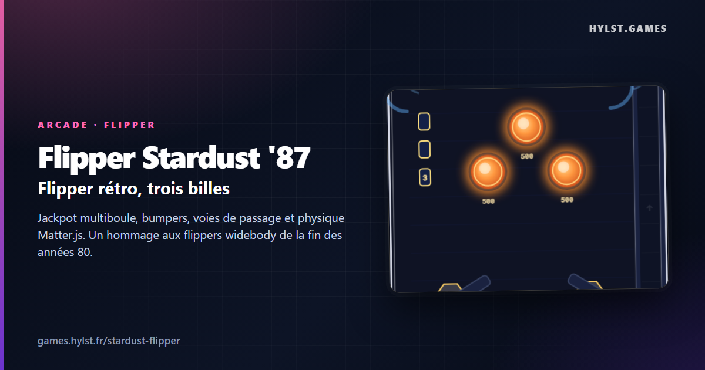

# Flipper Stardust '87

**Flipper rétro en canvas, trois billes et jackpot multiboule.**

Flipper Stardust '87 est un flipper widebody inspiré de la fin des années 80. La physique est simulée avec Matter.js, le rendu est en Canvas 2D et les commandes fonctionnent au clavier, à la souris ou au doigt. Le score et le record sont conservés dans le navigateur.

Joue ici : [games.hylst.fr/stardust-flipper/](https://games.hylst.fr/stardust-flipper/)



## Contrôles

| Action | Clavier | Tactile |
|---|---|---|
| Flipper gauche | Flèche gauche, A, Z ou Q | Bouton FLIPPER GAUCHE |
| Flipper droit | Flèche droite ou D | Bouton FLIPPER DROIT |
| Plongeur | Maintenir Espace ou Flèche bas | Bouton TIREZ / LANCEZ |
| Nouvelle partie | N | Bouton Rejouer |

## Fonctionnalités

- Trois billes, jackpot multiboule et multiplicateur jusqu'à 6x.
- Écran de fin avec bouton Rejouer : le score courant repart à zéro, le record est conservé.
- Bumpers, voies de passage, cibles tombantes, slingshots et orbites.
- Physique Matter.js à 60 images par seconde.
- Secousse du cabinet et effets sonores synthétisés.
- Record local conservé sous la clé `pin87_hs`.
- Interface responsive, commandes tactiles et clavier.

## Technique

- React 19, TypeScript, Vite 7 et Tailwind CSS 4.
- Matter.js pour la physique, Canvas 2D pour le rendu.
- Polices Fragment Mono, Space Grotesk et Syne auto-hébergées dans `public/fonts/`.
- Build en un seul fichier `index.html`.
- Aucune requête réseau pendant la partie, aucun compte, aucun cookie.

```bash
npm ci
npm run build
```

Le build sort dans `dist/` et se sert sous `/stardust-flipper/`.

## Structure

```
src/App.tsx      table, physique, rendu, interface et sons
src/index.css    styles et polices
public/fonts/    polices woff2 et feuille fonts.css
```

## Données locales

Le record est enregistré dans `localStorage` sous la clé `pin87_hs`. Aucune donnée nominative n'est collectée.

## Licence

AGPL-3.0-or-later. Voir `LICENSE`.

Jeu créé par Geoffroy Streit (Hylst) avec l'aide d'une IA.
